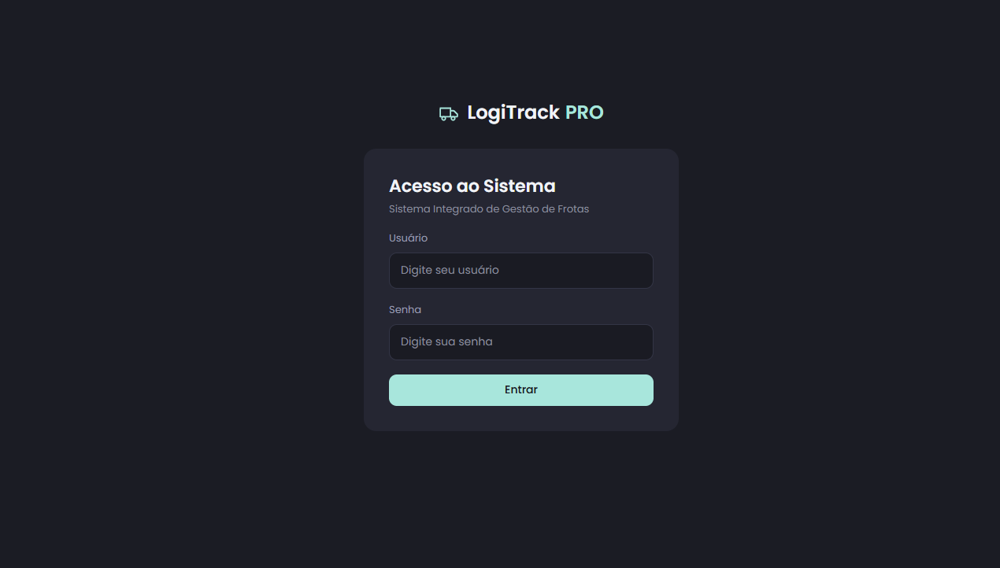
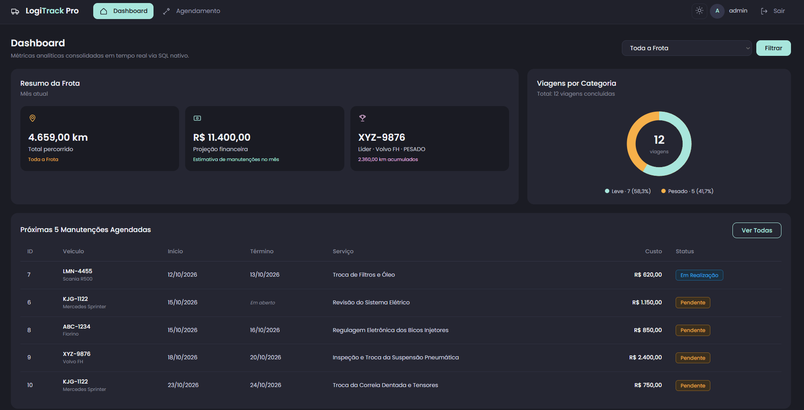
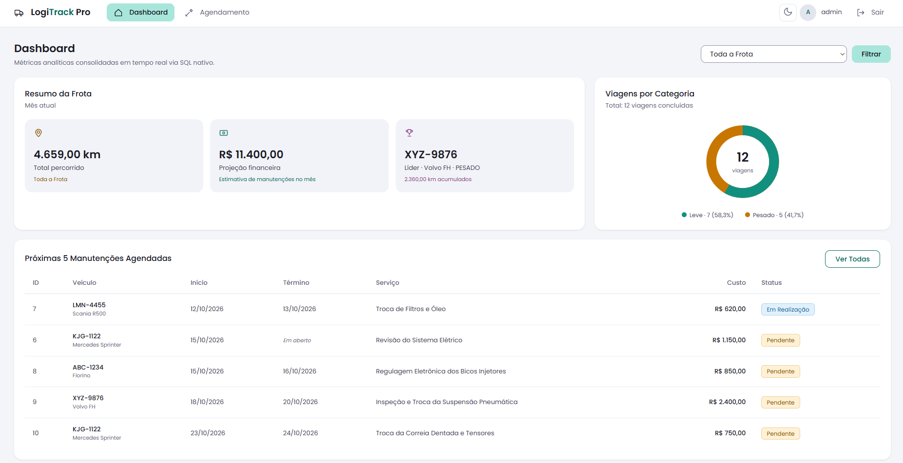
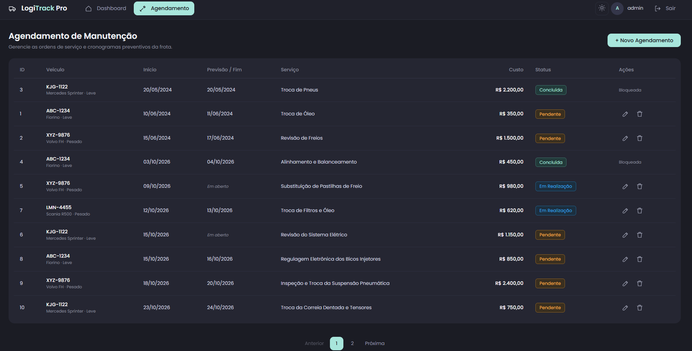
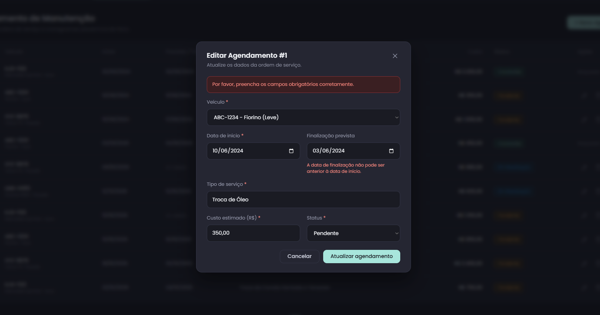

# LogiTrack Pro — Sistema de Gestão de Frotas e Manutenções

Aplicação web desenvolvida em Java 17 com Spring Boot 3.3.4, Thymeleaf e PostgreSQL 16 para gestão de ordens de serviço preventivas e análise operacional de frotas rodoviárias, desenvolvida para o desafio técnico da LogAp.

Link da aplicação em produção: [DEPLOY_URL_AQUI](https://logitrack-pro-cchv.onrender.com)

> **Aviso sobre o ambiente em nuvem:** A aplicação está hospedada no plano gratuito do Render. Instâncias gratuitas entram em modo de suspensão após períodos sem requisições. Caso o serviço esteja inativo, a primeira resposta pode levar cerca de 1 minuto para inicializar o contêiner.

---

## 1. Demonstração Visual

### Tela de Autenticação


### Dashboard Operacional e Analítico (Modo Escuro)


### Dashboard Operacional e Analítico (Modo Claro)


### Agendamento de Manutenção (Listagem e Modais)


### Validação Assíncrona no Modal


---

## 2. Funcionalidades do Sistema

### 2.1. Módulo Escolhido: Agendamento de Manutenção
Dentre as duas opções de módulo propostas no desafio (Controle de Viagens ou Agendamento de Manutenção), foi selecionado o **Agendamento de Manutenção**. 

**Justificativa:** A indisponibilidade mecânica não planejada e a falta de previsibilidade de gastos são gargalos críticos na operação logística. Este módulo resolve diretamente esses pontos ao centralizar o cronograma de ordens de serviço, além de alimentar de forma direta os dois indicadores financeiros e preventivos do dashboard analítico (cronograma das próximas 5 manutenções e projeção financeira do mês atual).

### 2.2. Regras de Negócio Implementadas
- **Validação de Cronologia:** A data de finalização prevista (`dataFinalizacao`) deve ser igual ou posterior à data de início (`dataInicio`). A regra é garantida em três camadas: no banco de dados via constraint `chk_manutencoes_datas`, no serviço via `RegraNegocioException` e na interface com feedback visual.
- **Validação Financeira:** O custo estimado (`custoEstimado`) é obrigatório e não pode assumir valores negativos, sendo validado por `chk_manutencoes_custo` e `@DecimalMin("0.00")`.
- **Imutabilidade de Manutenções Concluídas:** Registros com status `CONCLUIDA` são bloqueados contra edição e exclusão. Tentativas de alteração disparam `OperacaoNaoPermitidaException` e a interface desativa as ações correspondentes.
- **Integridade Referencial de Veículos:** O agendamento exige a seleção de um veículo cadastrado (`@NotNull veiculoId`). Caso o identificador não exista na base, o sistema lança `EntidadeNaoEncontradaException`.
- **Domínio Estrito de Status:** O status aceita apenas os valores `PENDENTE`, `EM_REALIZACAO` e `CONCLUIDA`, espelhados pelo enum Java `StatusManutencao` e assegurados pelo `chk_manutencoes_status` no PostgreSQL.
- **Interface com Modais e Validação Assíncrona:** Abertura de janelas modais para criação, edição e confirmação de exclusão definitiva. Submissões inválidas são interceptadas via `fetch`, exibindo erros inline sem desarmar o modal e sem recarregar a página para formulários externos.

### 2.3. Dashboard Analítico
- Exibição de 5 métricas operacionais consolidadas.
- Todas as métricas são calculadas diretamente no banco de dados via SQL nativo puro, sem processamento de agregações em memória.
- Filtro interativo por veículo para consulta isolada da quilometragem percorrida.

### 2.4. Autenticação e Credenciais de Demonstração
- Controle de acesso obrigatório via Spring Security com proteção CSRF e logout seguro.
- Suporte a credenciais de demonstração na tela de login (`admin` / `admin123`), acionadas por botão secundário que preenche os campos automaticamente apenas quando a variável `DEMO_LOGIN=true` estiver ativa no ambiente.

### 2.5. Design System e Tema Claro/Escuro
- Alternância dinâmica entre tema escuro e tema claro através de variáveis CSS customizadas (`data-theme="dark"` / `data-theme="light"`).
- Persistência da preferência no `localStorage` do navegador com detecção inicial via `prefers-color-scheme`.
- Interface construída com CSS puro (sem frameworks pesados) e tipografia Poppins auto-hospedada em formato WOFF2.

---

## 3. Como Executar a Aplicação

### 3.1. Execução via Docker (Recomendado)

O repositório inclui configuração completa com Docker Compose para subir a aplicação e o banco PostgreSQL 16 com migrações automáticas do Flyway.

```bash
docker compose up --build
```

- **URL da aplicação:** [http://localhost:8080](http://localhost:8080)
- **Credenciais de demonstração:**
  - Usuário: `admin`
  - Senha: `admin123`
  > **Nota de segurança:** Estas credenciais destinam-se exclusivamente a testes e avaliação do desafio técnico.

Para encerrar a execução:
```bash
docker compose down
```

### 3.2. Execução Local (sem Docker)

#### Pré-requisitos
- Java Development Kit (JDK) 17 ou superior.
- Apache Maven 3.9+.
- PostgreSQL 16 instalado e em execução na porta 5432.

#### Passos
1. Crie uma base de dados no PostgreSQL chamada `logitrack`:
   ```sql
   CREATE DATABASE logitrack;
   ```
2. Defina as variáveis de ambiente necessárias (ou utilize os valores padrão):
   - `DB_URL`: `jdbc:postgresql://localhost:5432/logitrack`
   - `DB_USERNAME`: `postgres`
   - `DB_PASSWORD`: `postgres`
   - `PORT`: `8080` (opcional)
   - `DEMO_LOGIN`: `true` (opcional, para exibir botão de demonstração no login)

3. Inicie a aplicação via Maven:
   ```bash
   mvn spring-boot:run
   ```

A aplicação executará as migrações do Flyway automaticamente na inicialização e estará acessível em `http://localhost:8080`.

### 3.3. Execução dos Testes Automatizados

A suíte de testes contempla testes unitários e de integração de serviços, repositórios, controle de acesso e comportamento do login de demonstração.

```bash
mvn clean verify
```

> **Atenção:** Os testes de integração (`DashboardRepositoryTest`, `AutenticacaoIntegrationTest` e `DemoLoginIntegrationTest`) utilizam **Testcontainers** com contêiner efêmero do PostgreSQL 16. Portanto, o serviço do Docker precisa estar em execução no ambiente durante a execução do comando.

---

## 4. Arquitetura e Decisões Técnicas

- **Padrão em Camadas:** Estrutura estrita `Controller` -> `Service` -> `Repository` -> `Entity`.
- **Organização de Pacotes:**
  - `com.logitrack.dashboard`: Projeções de banco, consultas analíticas e controller do painel.
  - `com.logitrack.manutencao`: Entidade `Manutencao`, DTOs de entrada/saída, regras de negócio e endpoints.
  - `com.logitrack.veiculo`: Entidade `Veiculo`, repositório e serviços de consulta da frota.
  - `com.logitrack.viagem`: Entidade `Viagem` mapeada para agregação de quilometragem e categorias.
  - `com.logitrack.security`: Configurações de segurança, `JpaUserDetailsService`, entidade `Usuario` e binding de `DemoLoginProperties`.
  - `com.logitrack.config`: Manipuladores globais de exceção (`GlobalExceptionHandler`) e interceptores.
- **Isolamento com DTOs:** Entidades JPA nunca são expostas diretamente em contratos de formulário ou APIs. O fluxo utiliza DTOs dedicados: `ManutencaoRequest` para recepção e validação via Bean Validation (`@Valid`) e `ManutencaoResponse` para exibição na interface.
- **Versionamento de Schema com Flyway:** O Hibernate atua em modo estrito de validação (`spring.jpa.hibernate.ddl-auto: validate`). O schema é evoluído exclusivamente através de migrações SQL versionadas, sem alterações automáticas em tempo de execução.
- **SQL Nativo no Dashboard:** Agregações, somas e percentuais são executados diretamente no PostgreSQL (`nativeQuery = true`). Não são utilizadas streams em memória do Java para cálculos agregados da frota.
- **Spring Security Customizado:** Configuração de `SecurityFilterChain` com formulário de login personalizado, proteção CSRF habilitada em todas as requisições de modificação, senhas criptografadas com `BCryptPasswordEncoder` e liberação seletiva de recursos públicos.
- **Desativação de Open-in-View:** A propriedade `spring.jpa.open-in-view` está explicitamente configurada como `false`. Isso impede abertura de transações de banco na camada de visualização (evitando o antipattern N+1 de queries tardias) e restringe transações ao escopo dos serviços (`@Transactional`).
- **Design System sem Dependências Externas:** Folha de estilos própria (`logitrack.css`) com tokens de cor e micro-animações. A família tipográfica Poppins foi incorporada localmente em arquivos WOFF2 (`src/main/resources/static/fonts/`), eliminando dependência de CDNs de terceiros ou falhas de conexão externa.

---

## 5. Banco de Dados e Evolução de Migrations

Os scripts de migração encontram-se em `src/main/resources/db/migration/`:

### `V1__carga_inicial.sql`
Script original fornecido na especificação do desafio técnico (`docs/Desafio LogAp - Carga Inicial.sql`), mantido intacto. Cria a estrutura inicial das tabelas `veiculos`, `viagens` e `manutencoes`, além de inserir dados estáticos datados do ano de 2024.

### `V2__ajustes.sql`
Aplica adequações estruturais, de integridade e de desempenho sobre a base inicial:
1. **Restrições CHECK:**
   - `chk_manutencoes_status`: Garante que `status` contenha apenas `'PENDENTE'`, `'EM_REALIZACAO'` ou `'CONCLUIDA'`.
   - `chk_manutencoes_datas`: Impede que a data de finalização seja anterior à data de início.
   - `chk_manutencoes_custo`: Garante que os custos estimados não sejam negativos.
   - `chk_viagens_datas`: Impede datas de chegada anteriores à data de saída.
   - `chk_viagens_km`: Impede registros de distâncias negativas.
2. **Índices de Otimização:**
   - `idx_viagens_veiculo_id` e `idx_manutencoes_veiculo_id`: Aceleram junções (JOINs) por chave estrangeira.
   - `idx_manutencoes_data_inicio`: Otimiza filtros temporais para projeções e ordenações.
   - `idx_manutencoes_agenda`: Índice parcial indexando `data_inicio` apenas onde `status <> 'CONCLUIDA'`. Reduz o tamanho do índice e acelera consultas do cronograma das manutenções ativas.
3. **Tabela `usuarios`:**
   - Criação da tabela de credenciais com campos `id`, `username` (UNIQUE NOT NULL), `password_hash` (VARCHAR 255) e `role` (VARCHAR 50).
4. **Carga Complementar com Datas Relativas:**
   - Inserção de registros em `manutencoes` e `viagens` utilizando expressões como `CURRENT_DATE`, `CURRENT_TIMESTAMP` e `INTERVAL`.
   - **Ressalva técnica:** Essas expressões foram avaliadas uma única vez no momento exato em que a migration foi executada pelo Flyway, persistindo valores de data definitivos no banco a partir de então.

### `V3__usuario_admin.sql`
Carga do usuário inicial com permissão administrativa (`admin` com hash BCrypt correspondente à senha `admin123` e perfil `ADMIN`).

---

## 6. Métricas do Dashboard e Consultas SQL

As métricas exibidas no dashboard são calculadas pelo repositório `DashboardRepository` via SQL nativo:

### 1. Total de KM Percorrido
- **Definição:** Soma da quilometragem percorrida apenas em viagens concluídas, com suporte a filtro opcional por veículo.
- **Decisão:** Viagens em trânsito (`data_chegada IS NULL`) são ignoradas para não distorcer a quilometragem real percorrida. O uso de `CAST(:veiculoId AS INTEGER)` assegura resolução de tipos no driver do PostgreSQL.
```sql
SELECT COALESCE(SUM(km_percorrida), 0)
FROM viagens
WHERE data_chegada IS NOT NULL
  AND (CAST(:veiculoId AS INTEGER) IS NULL OR veiculo_id = CAST(:veiculoId AS INTEGER))
```

### 2. Volume por Categoria (Leve vs Pesado)
- **Definição:** Distribuição quantitativa e percentual das viagens concluídas agrupadas por categoria de veículo (`LEVE` e `PESADO`).
- **Decisão:** Utilização de uma CTE com `VALUES ('LEVE'), ('PESADO')` acompanhada de `LEFT JOIN`. Isso garante que ambas as categorias sejam retornadas no resultado mesmo se uma delas possuir zero viagens. As funções `SUM(...) OVER ()` e `NULLIF` evitam erro de divisão por zero.
```sql
SELECT 
    c.tipo AS "tipo", 
    COUNT(v.id) AS "totalViagens",
    CAST(COALESCE(SUM(COUNT(v.id)) OVER (), 0) AS BIGINT) AS "totalGeral",
    COALESCE(ROUND(100.0 * COUNT(v.id) / NULLIF(SUM(COUNT(v.id)) OVER (), 0), 1), 0) AS "percentual"
FROM (VALUES ('LEVE'), ('PESADO')) AS c(tipo)
LEFT JOIN veiculos ve ON ve.tipo = c.tipo
LEFT JOIN viagens v ON v.veiculo_id = ve.id AND v.data_chegada IS NOT NULL
GROUP BY c.tipo
ORDER BY c.tipo
```

### 3. Cronograma das Próximas 5 Manutenções Agendadas
- **Definição:** Relação das próximas 5 manutenções em aberto com data de início igual ou superior ao dia atual.
- **Decisão:** Filtra `status <> 'CONCLUIDA'` aproveitando o índice parcial `idx_manutencoes_agenda`. A ordenação utiliza `data_inicio ASC` com desempate determinístico por `id ASC` e corte fixo em 5 registros (`LIMIT 5`).
```sql
SELECT 
    m.id AS "id",
    m.data_inicio AS "dataInicio",
    m.data_finalizacao AS "dataFinalizacao",
    m.tipo_servico AS "tipoServico",
    m.custo_estimado AS "custoEstimado",
    m.status AS "status",
    v.id AS "veiculoId",
    v.placa AS "veiculoPlaca",
    v.modelo AS "veiculoModelo"
FROM manutencoes m
JOIN veiculos v ON m.veiculo_id = v.id
WHERE m.status <> 'CONCLUIDA'
  AND m.data_inicio >= CURRENT_DATE
ORDER BY m.data_inicio ASC, m.id ASC
LIMIT 5
```

### 4. Ranking de Utilização (Veículo Líder)
- **Definição:** Identificação do veículo que acumulou a maior distância percorrida em viagens finalizadas.
- **Decisão:** Agrupamento por veículo e soma de quilometragem com critério de desempate por `v.id ASC`. O modificador `LIMIT 1` retorna o líder do ranking.
```sql
SELECT 
    v.id AS "veiculoId",
    v.placa AS "placa",
    v.modelo AS "modelo",
    v.tipo AS "tipo",
    SUM(vi.km_percorrida) AS "totalKm"
FROM viagens vi
JOIN veiculos v ON vi.veiculo_id = v.id
WHERE vi.data_chegada IS NOT NULL
GROUP BY v.id, v.placa, v.modelo, v.tipo
ORDER BY SUM(vi.km_percorrida) DESC, v.id ASC
LIMIT 1
```

### 5. Projeção Financeira do Mês Atual
- **Definição:** Totalização do custo estimado de manutenções programadas no mês corrente.
- **Decisão:** A consulta filtra por intervalo indexável `[início do mês, início do próximo mês)` sobre a coluna pura `data_inicio`. Isso evita aplicar funções de conversão sobre a coluna, preservando o uso do índice `idx_manutencoes_data_inicio`.
```sql
SELECT COALESCE(SUM(custo_estimado), 0)
FROM manutencoes
WHERE data_inicio >= date_trunc('month', CURRENT_DATE)::date
  AND data_inicio < (date_trunc('month', CURRENT_DATE) + INTERVAL '1 month')::date
```

---

## 7. Estratégia de Deploy em Produção (PaaS / Render)

A aplicação foi configurada para execução como serviço web em nuvem (Render Web Service) utilizando imagem de contêiner gerada a partir do `Dockerfile` multi-stage:
- **Build em dois estágios:** O primeiro estágio compila os binários com Maven 3.9 e OpenJDK 17; o segundo utiliza a imagem enxuta `eclipse-temurin:17-jre-alpine` executando sob usuário sem privilégios de root (`appuser`).
- **Compatibilidade com Proxy Reverso HTTPS:** O `application.yml` define `server.forward-headers-strategy: framework`, garantindo que os redirecionamentos gerados pelo Spring Security respeitem o protocolo HTTPS do proxy reverso.
- **Variáveis de Ambiente Configuradas na Nuvem:**
  - `PORT`: Porta dinâmica atribuída pela plataforma de hospedagem.
  - `DB_URL`: String JDBC de conexão ao banco PostgreSQL em nuvem.
  - `DB_USERNAME`: Usuário da base de dados gerenciada.
  - `DB_PASSWORD`: Senha de acesso ao banco gerenciado.
  - `DEMO_LOGIN`: Definido como `true` para liberar o facilitador de credenciais no ambiente de avaliação.
  - `JAVA_OPTS`: Ajustado com `-XX:MaxRAMPercentage=75` para evitar consumo excessivo de memória além dos limites do contêiner.

---

## 8. Limitações Conhecidas e Próximos Passos

### Limitações Conhecidas
- **Escopo do Módulo Operacional:** Em conformidade com a opção de escolha do desafio técnico, apenas o módulo de Agendamento de Manutenção possui interface completa de gerenciamento (CRUD). A tabela de viagens é utilizada exclusivamente para alimentação analítica do dashboard.
- **Perfil Único de Acesso:** A autenticação contempla o perfil administrativo (`ADMIN`). Não há separação granular de permissões por perfil (ex.: operador, motorista, gestor de frota).
- **Datas Relativas da Migration V2:** Como os registros de teste da migration V2 foram gravados na data de execução do script pelo Flyway, novas manutenções devem ser agendadas pelo usuário para refletir no cronograma dos meses subsequentes.

### Próximos Passos
- Implementação de interface gráfica dedicada para o CRUD de Viagens (Opção A do desafio).
- Criação de papéis de autorização granulares (`ROLE_GESTOR`, `ROLE_OPERADOR`) com controle de edição por perfil.
- Exportação de relatórios consolidados em formato PDF e planilhas estruturadas para auditoria de custos e quilometragem.
- Notificações automáticas para alertas de manutenções com prazo próximo via e-mail ou webhook.